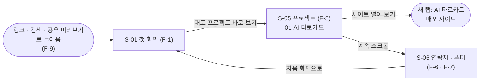

# 이원영 웹 포트폴리오 유저플로우

## 대표 프로젝트 바로 보기 (시나리오 1)



## 처음부터 훑어보기 · 연락하기 (시나리오 2 · 3)

```mermaid
flowchart LR
    S1["S-01 첫 화면 (F-1)"] -->|포트폴리오 보기| S2["S-02 히어로 (F-3)<br/>+ 고정 메뉴바 (F-2)"]
    S2 -->|스크롤| S4["S-04 소개 · 역량<br/>(F-3 · F-4)"]
    S4 -->|스크롤| S5["S-05 프로젝트 (F-5)"]
    S5 -->|스크롤| S6["S-06 연락처 · 푸터<br/>(F-6 · F-7)"]
    S2 -->|메뉴 버튼| S3["S-03 메뉴 열림 (F-2)"]
    S3 -->|소개 · 역량| S4
    S3 -->|프로젝트| S5
    S3 -->|연락처| S6
    S3 -->|Esc · 메뉴 버튼| S2
    S3 -->|처음 화면 (F-7)| S1
    S6 -->|GitHub| GH(["새 탭: GitHub"])
    S6 -->|처음 화면으로| S1
```

- 대표 프로젝트를 보고 [사이트 열어 보기]를 누르면 핵심 이용 끝. 끝까지 보기와 연락은 선택. (F-1 · F-5)
- 메뉴바는 스크롤해도 위에 붙어 있어서, S-04~S-06 어디서든 S-03을 열 수 있다. (F-2)
- 메뉴 항목을 누르면 메뉴가 닫히고 해당 섹션이 메뉴바 아래 110px 위치에 온다. (F-2 · 원칙 4)
- 연락처는 GitHub 링크 하나다. 자료에 없는 이메일 · SNS는 싣지 않는다. (F-6 · 원칙 2)
- [처음 화면]은 메뉴 · 하단 안내 · 푸터 세 곳에서 누를 수 있다. (F-7)
- 섹션은 처음 보일 때 한 번만 떠오르고, 움직임 줄이기 설정이면 바로 보인다. (F-8)
